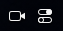
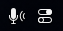

# Quick Settings Icon

A GNOME Shell extension that replaces the row of quick settings indicators in the top panel (network, volume, battery, etc.) with a single macOS-style Control Center icon.

<p align="center"></p>

## Features

- One clean toggle-switch icon instead of many status icons.
- Clicking it opens the normal GNOME quick settings menu, which works the same as before.
- **Privacy indicators stay visible.** Camera, microphone, location and screen-sharing / remote-access indicators still show up next to the icon, so you always see when they're in use.
- Disabling the extension puts the panel back exactly how it was.

## Screenshots

| Camera in use | Microphone in use | Location in use |
|:---:|:---:|:---:|
|  |  |  |

> The location indicator only appears while an app is actively using your location, not whenever the Location toggle is on. This matches stock GNOME behavior.

## Requirements

- GNOME Shell 45–50

## Installation

```bash
git clone https://github.com/yousif-gh/gnome-quicksettings.git \
  ~/.local/share/gnome-shell/extensions/quicksettings-icon@yousif-gh.dev
```

Log out and back in (required on Wayland), then enable it:

```bash
gnome-extensions enable quicksettings-icon@yousif-gh.dev
```

To disable:

```bash
gnome-extensions disable quicksettings-icon@yousif-gh.dev
```

## How it works

GNOME's quick settings button keeps its icons in an internal `_indicators` box. The extension:

1. Hides that box.
2. Puts a new box at the start of the button, holding the privacy indicators and the Control Center icon.
3. Watches `_indicators` for new children, because quick settings creates its indicators asynchronously at login.

## Files

| File | Purpose |
|------|---------|
| `metadata.json` | Extension metadata (UUID, name, supported shell versions) |
| `extension.js` | Extension logic |
| `control-center-symbolic.svg` | The panel icon |

## Debugging

```bash
journalctl -f -o cat /usr/bin/gnome-shell
```
